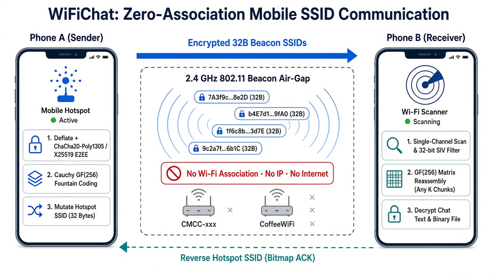
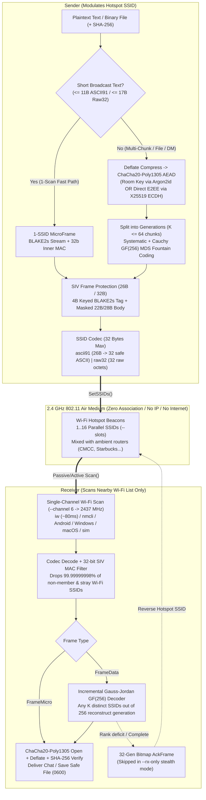
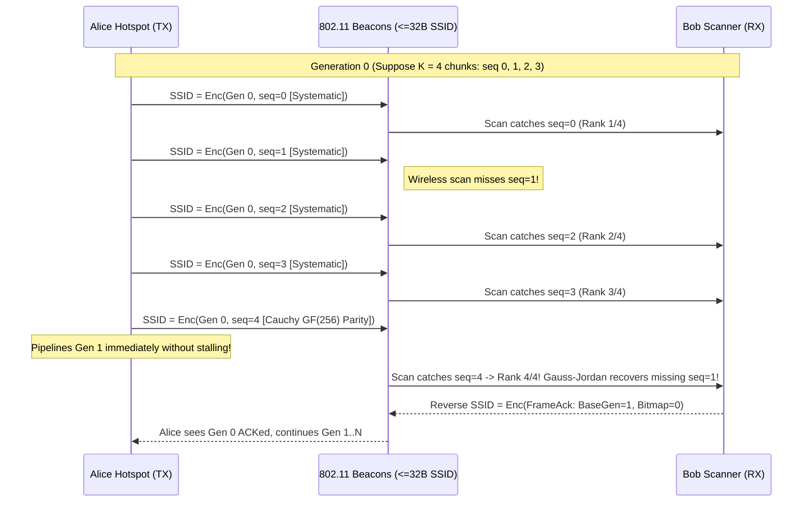

# WiFiChat

[](https://github.com/esrrhs/wifichat/actions/workflows/ci.yml)
[](go.mod)
[](#usage)
[](#core-design)
[](https://github.com/esrrhs/wifichat/commits/master)
[](https://github.com/esrrhs/wifichat/stargazers)

[English](README.md) | [中文](README_zh.md)

**WiFiChat** is an anonymous, zero-association nearby communication tool that transmits **encrypted text messages** and **binary files** purely by modulating **32-byte Wi-Fi hotspot names (SSIDs)** and scanning nearby 802.11 beacons.

Clients **never connect (associate)** to each other's Wi-Fi networks, never obtain IP addresses, never open TCP/UDP sockets, and require zero Internet, SIM cards, or servers.

---

## How It Works



Normally, Wi-Fi devices must associate with an access point before exchanging IP packets — leaving MAC, DHCP, and connection logs on the AP. However, every Wi-Fi hotspot continuously broadcasts **IEEE 802.11 Beacon** management frames (~10–20 times per second) containing its **SSID (up to 32 bytes)** so nearby phones and laptops can list nearby Wi-Fi names **before connecting**.

WiFiChat turns this unassociated 802.11 Beacon/Scan channel into an encrypted, erasure-coded air-gap data bus:



### 32-Byte SSID Wire Frame Layout (`ascii91` Default Mode)

```text
 802.11 Beacon SSID (32 safe printable ASCII chars, no spaces/quotes/backslashes)
 ┌──────────────────────────────────────────────────────────────────────────────┐
 │                Base91 Encoded String (91^32 > 256^26 = 208 bits)             │
 └──────────────────────────────────────┬───────────────────────────────────────┘
                                        ▼
 Raw Decoded Frame (26 Bytes)
 ┌────────────────────┬─────────────────────────────────────────────────────────┐
 │  Frame Tag (4 B)   │           SIV-Masked Frame Body (22 Bytes)              │
 │ BLAKE2s(K_mac,body)│       body XOR BLAKE2s(K_mask, Frame Tag)[0:22]         │
 └────────────────────┴─────────────────────────┬───────────────────────────────┘
                                                ▼ Unmasked Body Variants (22 Bytes)
 [00] FrameData (Multi-Chunk Text / File):
 ┌──────────┬───────────┬───────────────┬─────────┬─────────────────────────────┐
 │00│ K-1(6b)│XferID(2B) │Final(1b)Gen15b│ Seq(1B) │   FEC Chunk Data (16 Bytes) │
 └──┴───────┴───────────┴───────────────┴─────────┴─────────────────────────────┘
   1 Byte      2 Bytes       2 Bytes       1 Byte     seq < K: Systematic
                                                      seq >= K: Cauchy GF(256) Parity
 [11] FrameMicro (1-SSID Instant Short Chat):
 ┌──────────┬───────────┬───────────────┬─────────┬─────────────────────────────┐
 │11│C│Len5b│PeerShort2B│  Nonce (4B)   │MAC2 (4B)│  Encrypted UTF-8 (<= 11 B)  │
 └──┴─┴─────┴───────────┴───────────────┴─────────┴─────────────────────────────┘

 [01] FrameAck (Sliding-Window Feedback):
 ┌──────────┬───────────┬───────────────┬─────────┬──────────────┬──────┬───────┐
 │01│Flags6b│XferID(2B) │ AckPeerID(4B) │BaseGen2B│GenBitmap(4B) │Need1B│Pad(8B)│
 └──────────┴───────────┴───────────────┴─────────┴──────────────┴──────┴───────┘
```

### Fountain Streaming & Loss Recovery Sequence

Because OS Wi-Fi scans run asynchronously and are not phase-locked with the sender's SSID rotation, traditional stop-and-wait ARQ would stall for seconds on every 16-byte chunk. Instead, WiFiChat streams systematic + Cauchy $\text{GF}(256)$ MDS repair SSIDs continuously across a sliding generation window:



### Peer Discovery & Addressing Over Broadcast Wi-Fi

Although 802.11 beacons are physically broadcast to everyone nearby, WiFiChat separates rooms, identities, and private conversations across three layers:

1. **Channel Isolation (`-k <passphrase>`):** Passphrases derive outer SIV-MAC and room AEAD keys via `Argon2id` (32 MiB). Non-members fail the 4-byte outer MAC check immediately and see only random router names.
2. **Automatic Ephemeral Discovery (`KindHello`):** Each client generates a RAM-only `X25519` keypair on startup, derives a 4-byte `PeerID` (`BLAKE2s(X25519Pub)[:4]`, default alias `anon-xxxx`), and announces its `X25519` public key in a compact `Hello` envelope. Already-online nodes automatically reply with a reactive `Hello` when a new peer appears, populating `/peers` within sub-second latency.
3. **Broadcast vs. Direct E2EE (`@<peer>` / `/sendfile <peer>`):**
   * **Broadcast messages** carry `SenderID` + `Nick` and are readable by all members of the active channel.
   * **Direct E2EE transfers** carry `RecipientID` (non-recipients immediately ignore the envelope and suppress ACKs) and encrypt the payload under `HKDF(X25519(senderPriv, recipientPub))`, verifying `DerivePeerID(senderPub) == SenderID` to prevent sender spoofing. Nearby users can compare 6-hex **SAS** codes (`/peers`, e.g. `7F2-C19`) to rule out active MITM.

---

## Core Design

### 1. Anonymity
* **Zero Association & Passive Reception:** Receivers only scan nearby 802.11 SSIDs. With `--rx-only` (or `wifichat recv`), a receiver never transmits a single Wi-Fi frame or hotspot beacon.
* **RAM-Only Ephemeral Identity:** No account files or long-term keys are written to disk. Run `/rotate` at any time to rotate ephemeral `X25519` keys, `PeerID`, alias, and SoftAP MAC address (`02:xx:xx:xx:xx:xx`).
* **Traffic & SSID Camouflage:** Frame headers are masked via Synthetic-IV (`BLAKE2s`), leaving zero plaintext magic bytes or sequence numbers on the air. Optional `--prefix "CMCC-"` / `--decoy "TP-LINK_8A2F"` / `--stealth` blend SSIDs into ordinary consumer Wi-Fi routers.

### 2. Security
* **Per-SSID SIV Protection:** 32-bit keyed `BLAKE2s` MAC + stream masking filters out 99.99999998% ($1 - 2^{-32}$) of stray or forged Wi-Fi SSIDs before erasure decoding.
* **Message & File AEAD:** Reassembled envelopes are authenticated and decrypted with **`ChaCha20-Poly1305`** (256-bit key, 128-bit Poly1305 tag, header-bound Associated Data), replay timestamp window checks, `SHA-256` file integrity verification, and traversal-safe `0600` file storage.

### 3. Speed Optimizations
* **High-Density Codecs:** `ascii91` packs **26 raw bytes (81.25% density)** into 32 safe printable ASCII chars; `raw32` packs **all 32 raw bytes** into the 802.11 SSID IE (`hostapd` `ssid2` hex + `iw` `\xHH` scan).
* **1-SSID Micro Fast-Path (`FrameMicro`):** Short broadcast messages ($\le 11$ bytes in `ascii91`, $\le 17$ bytes in `raw32`) fit inside a **single 32-byte SSID** with 64-bit authentication.
* **Pre-AEAD Deflate Compression:** Text and structured files are compressed (`flate.BestCompression`) prior to encryption whenever smaller.
* **Cauchy $\text{GF}(256)$ MDS Fountain + Multi-BSSID Striping (`--slots 1..16`):** Any $K$ distinct SSIDs out of 256 reconstruct a 64-chunk generation via incremental Gauss-Jordan elimination; `hostapd_cli UPDATE_BEACON` (<10ms) + single-channel `iw` scan (`2437 MHz`, ~80ms) scale throughput linearly across virtual AP slots.

---

## Simulated Throughput Benchmarks

Run `./bin/wifichat bench` to measure end-to-end effective rates (including `ChaCha20-Poly1305` / `X25519` overhead, SIV framing, asynchronous scan jitter, and wireless scan packet loss):

| Hardware Profile | Payload | Dwell / Scan | Scan Loss | Sim Time | Effective Rate | SSIDs Sent |
| :--- | :--- | ---: | ---: | ---: | ---: | ---: |
| Mobile Hotspot (`1 slot`, `ascii91`) | Short chat (`9 B`, 1-SSID) | `850ms / 550ms` | `15%` | `0.78 s` | `12 B/s` | `4` |
| Mobile Hotspot (`1 slot`, `ascii91`) | Multi-line UTF-8 text (`1.2 KB`) | `850ms / 550ms` | `15%` | `18.7 s` | `75 B/s` | `33` |
| Mobile Hotspot (`1 slot`, `ascii91`) | Random binary (`2 KB`) | `850ms / 550ms` | `15%` | `2m 10s` | `16 B/s` | `155` |
| Linux `nmcli + iw` (`1 slot`, `ascii91`) | Random binary (`4 KB`) | `650ms / 350ms` | `15%` | `3m 05s` | `22 B/s` | `287` |
| Linux `hostapd` (`1 slot`, `raw32`) | Random binary (`8 KB`) | `160ms / 120ms` | `15%` | `1m 23s` | `98 B/s` | `523` |
| Linux `hostapd` (`4 slots`, `raw32`) | Random binary (`16 KB`) | `160ms / 120ms` | `15%` | `40.5 s` | `405 B/s` | `1012` |
| Dual-NIC `hostapd` (`8 slots`, `raw32`) | Random binary (`32 KB`) | `120ms / 80ms` | `10%` | `35.5 s` | `923 B/s` | `2304` |
| Dual-NIC `hostapd` (`8 slots`, `raw32`) | Random binary (`32 KB`, heavy loss) | `120ms / 80ms` | `30%` | `38.4 s` | `854 B/s` | `2536` |
| Dual-NIC `hostapd` (`8 slots`, `raw32`) | Structured JSON/log (`32 KB`) | `120ms / 80ms` | `10%` | `4.92 s` | `6.51 KB/s` | `328` |
| Stealth `RX-Only` (`8 slots`, `raw32`) | Blind passive RX binary (`16 KB`) | `120ms / 80ms` | `15%` | `17.8 s` | `920 B/s` | `1170` |

---

## Build & Test

Requires Go 1.26+:

```bash
make build    # builds bin/wifichat
make test     # runs unit & integration tests with -race
```

---

## Usage

```bash
# Check detected Wi-Fi hotspot/scanner backends on this machine
./bin/wifichat drivers

# Run end-to-end throughput simulation across hardware profiles
./bin/wifichat bench

# Interactive anonymous nearby chat & file console (auto-selects driver)
./bin/wifichat -k "my-room-secret"

# High-speed Linux SoftAP mode (8 parallel SSIDs + Raw32 + dedicated scan radio)
sudo ./bin/wifichat -d hostapd --iface wlan0 --scan-iface wlan1 --slots 8 --encoding raw32 -k "my-room-secret"

# Mobile hotspot / custom script mode (Android ADB/Termux/OpenWrt)
./bin/wifichat -d android -k "my-room-secret"

# Pure passive stealth receiver (zero hotspot transmission; saves incoming files)
./bin/wifichat -k "my-room-secret" --download-dir ./inbox recv

# One-shot text or binary file send
./bin/wifichat -k "my-room-secret" send "Meet at exit B2"
./bin/wifichat -k "my-room-secret" --to anon-a47f sendfile ./map.png

# Local multi-terminal test without Wi-Fi hardware (virtual 802.11 air directory)
./bin/wifichat -d sim -k "demo"        # Terminal 1
./bin/wifichat -d sim -k "demo"        # Terminal 2
```

### Interactive Console Commands

| Command | Description |
| :--- | :--- |
| `<message>` | Broadcast encrypted text to nearby channel (1-SSID fast path if short) |
| `@<peer> <message>` | Send `X25519` E2EE private message to `<peer>` (alias or ID prefix) |
| `/sendfile <path>` | Broadcast compressed & AEAD-encrypted binary file |
| `/sendfile <peer> <path>` | Send `X25519` E2EE binary file directly to `<peer>` |
| `/peers` / `/who` | List discovered anonymous peers, ephemeral IDs, and SAS codes |
| `/rotate` | Rotate ephemeral `X25519` keypair, `PeerID`, alias, and AP MAC |
| `/key [passphrase]` | Switch `Argon2id` room passphrase at runtime |
| `/stealth [on\|off]` | Toggle quiet decoy-SSID idle mode |
| `/status` | Display current driver, active SSIDs on air, and frame counters |
| `q` / `/quit` | Exit, clean up hotspot SSID, and wipe RAM keys |

---

## Project Layout

```text
cmd/wifichat/   CLI entry point & subcommands (chat, send, sendfile, recv, scan, bench, drivers)
pkg/ssid/       Base91 (26B/32-char ASCII) & Raw32 SSID codecs, prefix & decoy helpers
pkg/fec/        GF(256) arithmetic & systematic Cauchy MDS fountain encoder/decoder
pkg/crypto/     RAM-only X25519 identity, Argon2id+HKDF keys, SIV frame MAC, ChaCha20-Poly1305
pkg/protocol/   Compact Data/Ack/Micro wire frames & compressed Text/File/Hello envelopes
pkg/wifi/       Drivers: Linux hostapd/iw, nmcli, Android, macOS, Windows, custom cmd, sim
pkg/engine/     Multi-slot fountain scheduler, sliding-window ARQ, deduplication, file writer
pkg/cli/        Interactive console, one-shot CLI handlers & throughput simulator
```

---

## Physical & Practical Notes

* **Throughput vs. Hardware:** IEEE 802.11 limits each SSID to 32 bytes. Single mobile hotspots achieve sub-second short chat and ~16–75 B/s sustained transfer; Linux `hostapd` with `--slots 8 --encoding raw32` and single-channel `iw` scan reaches ~0.9 KB/s on raw random binary and >6 KB/s on compressible logs/documents — suited for chat, coordinates, keys, patches, and compact files rather than large media streams.
* **Radio Range & Dual-NIC Tip:** Range follows physical 2.4 GHz beacon propagation (~30–150 m). Some single-radio drivers restrict scanning while in AP mode unless `ap-force` is supported; pairing a cheap USB Wi-Fi adapter (`--iface wlan0 --scan-iface wlan1`) provides full-duplex TX + continuous 80 ms scanning.
