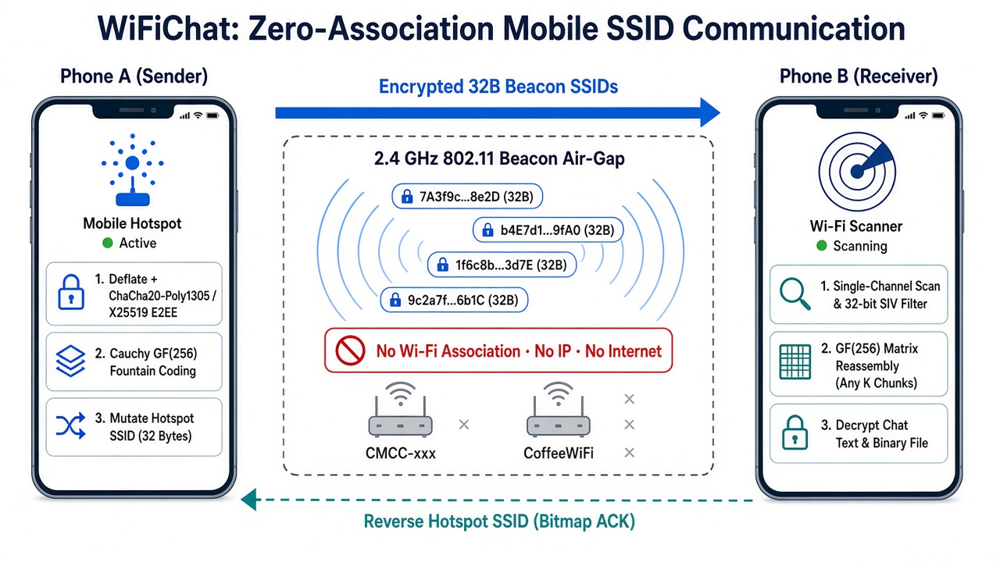
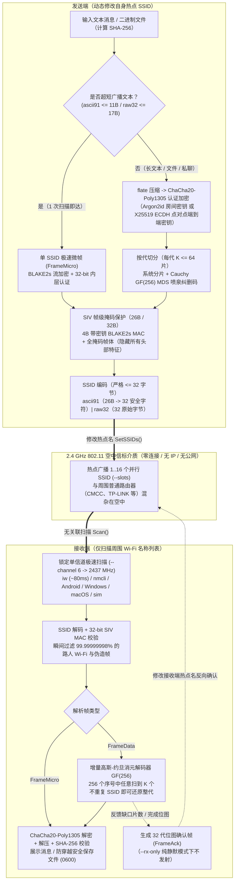
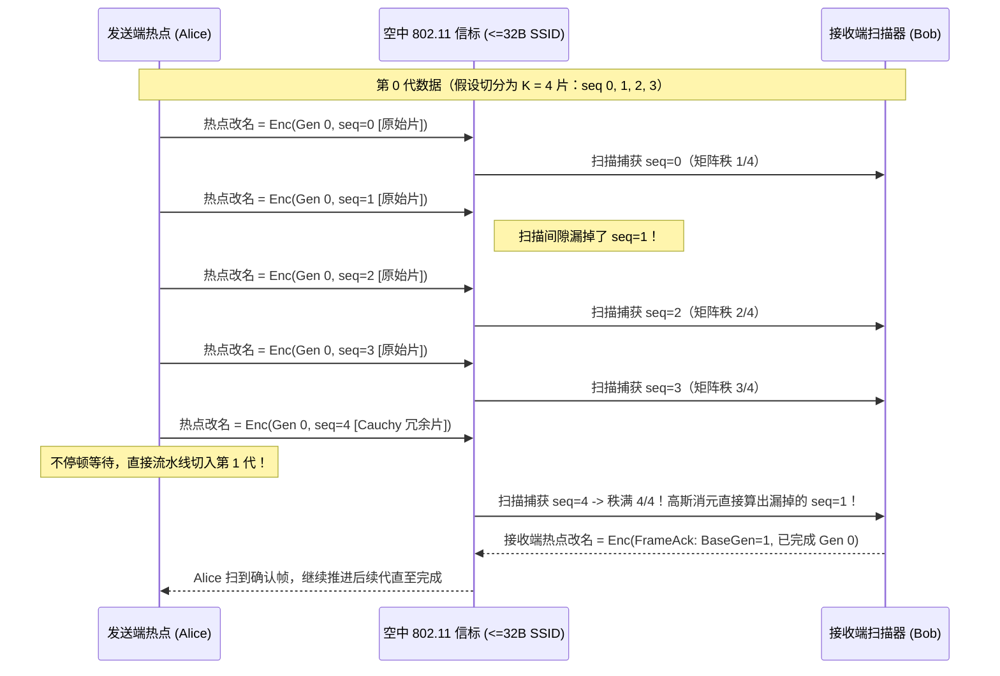

# WiFiChat

[](https://github.com/esrrhs/wifichat/actions/workflows/ci.yml)
[](go.mod)
[](#快速上手)
[](#核心特性)
[](https://github.com/esrrhs/wifichat/commits/master)
[](https://github.com/esrrhs/wifichat/stargazers)

[English](README.md) | [中文](README_zh.md)

**WiFiChat** 是一个基于 **Wi-Fi 热点名称（SSID，最长 32 字节）** 的近距离**匿名加密文本聊天与二进制文件传输**工具。

每个客户端仅通过**动态修改自身共享热点名称（802.11 Beacon SSID）**并扫描周围 Wi-Fi 列表来收发数据：**无需连接对方的 Wi-Fi 热点**，不分配 IP，不建立任何 TCP/UDP 连接，完全脱离互联网、运营商基站或任何服务器运行。

---

## 通信实现原理



正常使用 Wi-Fi 时，设备必须先“连接（Associate）”上路由器并获取 IP 才能收发数据包，这会在路由器侧留下 MAC、DHCP 租约和连接日志。但在连接之前，任何开启热点的手机或电脑都会以每秒约 10～20 次的频率向空中广播 **IEEE 802.11 Beacon（信标帧）**，其中包含明文可见的 **Wi-Fi 名字（SSID，标准上限 32 字节）**。

**WiFiChat 把这个“无需连接即可被周围设备扫到”的 32 字节 SSID 变成了加密、抗丢包的空中数据总线：**



### 32 字节 SSID 帧结构拆解（以默认通用 `ascii91` 模式为例）

```text
 空中 802.11 Wi-Fi 名称（32 个安全可打印 ASCII 字符，不含空格/引号/反斜杠）
 ┌──────────────────────────────────────────────────────────────────────────────┐
 │                Base91 编码字符串（91^32 > 256^26 = 208 bits）                 │
 └──────────────────────────────────────┬───────────────────────────────────────┘
                                        ▼
 解码后的 26 字节原始帧
 ┌────────────────────┬─────────────────────────────────────────────────────────┐
 │   帧认证标签 (4B)   │              SIV 流掩码帧体 (22 Bytes)                   │
 │ BLAKE2s(K_mac,body)│         body XOR BLAKE2s(K_mask, Tag)[0:22]             │
 └────────────────────┴─────────────────────────┬───────────────────────────────┘
                                                ▼ 脱掩码后的 3 种 22 字节帧体
 [00] FrameData（长文本 / 二进制文件喷泉分片帧）：
 ┌──────────┬───────────┬───────────────┬─────────┬─────────────────────────────┐
 │00│ K-1(6b)│XferID(2B) │Final(1b)Gen15b│ Seq(1B) │    纠删码分片净荷 (16 Bytes) │
 └──┴───────┴───────────┴───────────────┴─────────┴─────────────────────────────┘
   1 Byte      2 Bytes       2 Bytes       1 Byte     seq < K: 原始系统分片
                                                      seq >= K: Cauchy GF(256) 冗余片
 [11] FrameMicro（单 SSID 极速短消息帧）：
 ┌──────────┬───────────┬───────────────┬─────────┬─────────────────────────────┐
 │11│C│Len5b│PeerShort2B│  Nonce (4B)   │MAC2 (4B)│   加密 UTF-8 文本 (<= 11 B)  │
 └──┴─┴─────┴───────────┴───────────────┴─────────┴─────────────────────────────┘

 [01] FrameAck（多代滑动窗口位图确认帧）：
 ┌──────────┬───────────┬───────────────┬─────────┬──────────────┬──────┬───────┐
 │01│Flags6b│XferID(2B) │ AckPeerID(4B) │BaseGen2B│GenBitmap(4B) │Need1B│Pad(8B)│
 └──────────┴───────────┴───────────────┴─────────┴──────────────┴──────┴───────┘
```

### 喷泉纠删码流水线时序（消除停等重传卡顿）

修改热点名与系统扫描 Wi-Fi 是两套不同步的定时器，扫描间隙必然出现随机漏扫。WiFiChat 采用 **Cauchy $\text{GF}(256)$ 喷泉流 + 多代滑动窗口**：



### 广播信道下如何知道“谁在和我聊、我和谁聊”？

1. **频道口令隔离（`-k <口令>`）：** 口令经 `Argon2id`（32 MiB）派生外层帧 MAC 与房间密钥；无口令者连第一层 4 字节 MAC 都无法通过，只会看到普通随机路由器名。
2. **内存临时公钥自动发现（`KindHello`）：** 每次启动在内存中生成一次性 `X25519` 公私钥并算出 4 字节 `PeerID`（默认代号 `anon-xxxx`），上线时自动广播 `Hello` 信标交换公钥；先上线的节点发现新节点时会自动响应式回发 `Hello`，输入 `/peers` 即可列出附近所有在线匿名节点。
3. **群聊广播 vs. 点对点私聊（`@<代号>` / `/sendfile <代号>`）：**
   * **直接输入文字**为房间内广播（带发送人 `SenderID` 与昵称）。
   * **`@<代号>` 私聊或指定对象发文件**会在头部写入目标 `RecipientID`（其他人直接忽略且不回 ACK），并用双方 `X25519` ECDH 共享密钥加密，同时校验 `DerivePeerID(senderPub) == SenderID` 防冒充；当面可核对 `/peers` 显示的 6 位 **SAS 短认证码**（如 `7F2-C19`）防中间人。

---

## 核心特性

* **强匿名性：** 零 Wi-Fi 关联，支持 `--rx-only` 零发射纯静默接收；无任何本地磁盘密钥文件；支持 `/rotate` 随时轮换密钥、ID、代号与随机 MAC；支持 `--prefix` / `--decoy` / `--stealth` 热点伪装。
* **双层安全：** 单帧 32-bit `BLAKE2s` SIV 防污染 + 完整消息/文件 256-bit `ChaCha20-Poly1305` AEAD 认证解密 + 时间戳防重放 + 二进制文件 `SHA-256` 端到端校验与防目录穿越安全保存（`0600`）。
* **多维提速：** `ascii91`（26B/SSID）与 `raw32`（32B/SSID）高密度编码、单 SSID `FrameMicro` 短消息极速通道、加密前自适应 `flate` 压缩、Cauchy $\text{GF}(256)$ MDS 喷泉纠删码、`hostapd` 最多 16 路并行虚拟热点（`<10ms` 刷新信标）与 `iw` 单频点极速扫描（`~80ms`）。

---

## 传输速率实测仿真（`./bin/wifichat bench`）

以下为运行真实引擎（含加密、帧头、异步扫描抖动及 10%～30% 随机漏扫丢包）测得的净有效载荷速率：

| 硬件模式档位 | 测试载荷 | 改名 / 扫描周期 | 漏扫丢包 | 仿真耗时 | 净有效速率 | 发送 SSID 数 |
| :--- | :--- | ---: | ---: | ---: | ---: | ---: |
| 手机单路共享热点（`1 slot`, `ascii91`） | 短消息（`9 B`, 单 SSID 通道） | `850ms / 550ms` | `15%` | `0.78 s` | `12 B/s` | `4` |
| 手机单路共享热点（`1 slot`, `ascii91`） | 多行中文坐标消息（`1.2 KB`） | `850ms / 550ms` | `15%` | `18.7 s` | `75 B/s` | `33` |
| 手机单路共享热点（`1 slot`, `ascii91`） | 纯随机二进制文件（`2 KB`） | `850ms / 550ms` | `15%` | `2m 10s` | `16 B/s` | `155` |
| Linux `nmcli + iw`（`1 slot`, `ascii91`） | 纯随机二进制文件（`4 KB`） | `650ms / 350ms` | `15%` | `3m 05s` | `22 B/s` | `287` |
| Linux `hostapd`（`1 slot`, `raw32`） | 纯随机二进制文件（`8 KB`） | `160ms / 120ms` | `15%` | `1m 23s` | `98 B/s` | `523` |
| Linux `hostapd`（`4 slots`, `raw32`） | 纯随机二进制文件（`16 KB`） | `160ms / 120ms` | `15%` | `40.5 s` | `405 B/s` | `1012` |
| 双网卡 `hostapd`（`8 slots`, `raw32`） | 纯随机二进制文件（`32 KB`） | `120ms / 80ms` | `10%` | `35.5 s` | `923 B/s` | `2304` |
| 双网卡 `hostapd`（`8 slots`, `raw32`） | 纯随机二进制（`32 KB`, 高干扰） | `120ms / 80ms` | `30%` | `38.4 s` | `854 B/s` | `2536` |
| 双网卡 `hostapd`（`8 slots`, `raw32`） | 结构化 JSON/日志（`32 KB`） | `120ms / 80ms` | `10%` | `4.92 s` | `6.51 KB/s` | `328` |
| 纯静默接收 `RX-Only`（`8 slots`, `raw32`） | 零发射盲收随机二进制（`16 KB`） | `120ms / 80ms` | `15%` | `17.8 s` | `920 B/s` | `1170` |

---

## 编译与测试

需要 Go 1.26 或更高版本：

```bash
make build    # 生成 bin/wifichat
make test     # 运行全套单元与高丢包集成测试（含 -race）
```

### Android App

[`android/`](android/) 下是 Jetpack Compose 手机客户端：用 `gomobile` 嵌入同一套 Go 引擎，并内置 **无线调试 ADB 运行时** 改 SoftAP SSID（无需另装 Shizuku）。未激活时自动 RX-only。

```bash
# 需要 Android SDK/NDK、JDK 17，以及：go install golang.org/x/mobile/cmd/gomobile@latest && gomobile init
make android-apk
# APK: android/app/build/outputs/apk/debug/app-debug.apk
```

手机端：打开 **无线调试**，在 App 设置里「激活 SoftAP TX」配对一次，授予定位/附近 Wi-Fi 权限，设置房间口令后点 Wi-Fi 按钮上线。未激活时仍可 **仅接收**。

详见 [`android/README.md`](android/README.md)。

---

## 快速上手

```bash
# 查看当前机器可用的 Wi-Fi 热点/扫描驱动后端
./bin/wifichat drivers

# 运行内置多硬件档位端到端传输速率仿真
./bin/wifichat bench

# 启动交互式匿名附近聊天与传文件终端（自动选择后端）
./bin/wifichat -k "room-passphrase"

# Linux 高速多 SSID 模式（hostapd 8 路并行 SSID + Raw32 编码 + 双网卡收发分离）
sudo ./bin/wifichat -d hostapd --iface wlan0 --scan-iface wlan1 --slots 8 --encoding raw32 -k "room-passphrase"

# 手机共享热点 / Android Termux / 自定义脚本驱动
./bin/wifichat -d android -k "room-passphrase"
./bin/wifichat -d cmd --tx-cmd 'uci set wireless.@wifi-iface[0].ssid={ssid} && wifi reload' --rx-cmd 'iwinfo wlan0 scan'

# 纯被动静默接收端（完全不开启热点，静默接收附近消息与二进制文件到 ./inbox）
./bin/wifichat -k "room-passphrase" --download-dir ./inbox recv

# 命令行单次发送文本或二进制文件
./bin/wifichat -k "room-passphrase" send "B2出口集合"
./bin/wifichat -k "room-passphrase" --to anon-a47f sendfile ./secret.zip

# 无无线网卡机器 / 本地多终端联调（基于共享虚拟 802.11 空中目录，严格经 32 字节 SSID 交互）
./bin/wifichat -d sim -k "demo"        # 终端 1
./bin/wifichat -d sim -k "demo"        # 终端 2
```

### 交互终端命令

| 命令 | 说明 |
| :--- | :--- |
| `<文本内容>` | 向附近频道加密广播文本（短消息自动走单 SSID 极速通道） |
| `@<代号/ID> <文本>` | 向指定附近节点发送 `X25519` 端到端加密私聊 |
| `/sendfile <文件路径>` | 向附近频道压缩并加密广播二进制文件 |
| `/sendfile <代号/ID> <文件路径>` | 向指定节点发送 `X25519` 端到端加密二进制文件 |
| `/peers` 或 `/who` | 查看已发现的附近匿名节点、临时 ID 与 SAS 验证码 |
| `/rotate` | 立即轮换内存临时密钥对、匿名 ID、昵称与热点 MAC |
| `/key [新口令]` | 动态切换房间口令（`Argon2id`） |
| `/stealth [on\|off]` | 开启/关闭空闲诱饵热点静默模式 |
| `/status` | 查看当前驱动、空中实时 SSID 列表及收发帧计数 |
| `q` / `/quit` | 退出程序，清理热点并擦除内存密钥 |

---

## 目录说明与物理边界

见英文主文档 [Project Layout](README.md#project-layout) 与 [Physical & Practical Notes](README.md#physical--practical-notes)。
